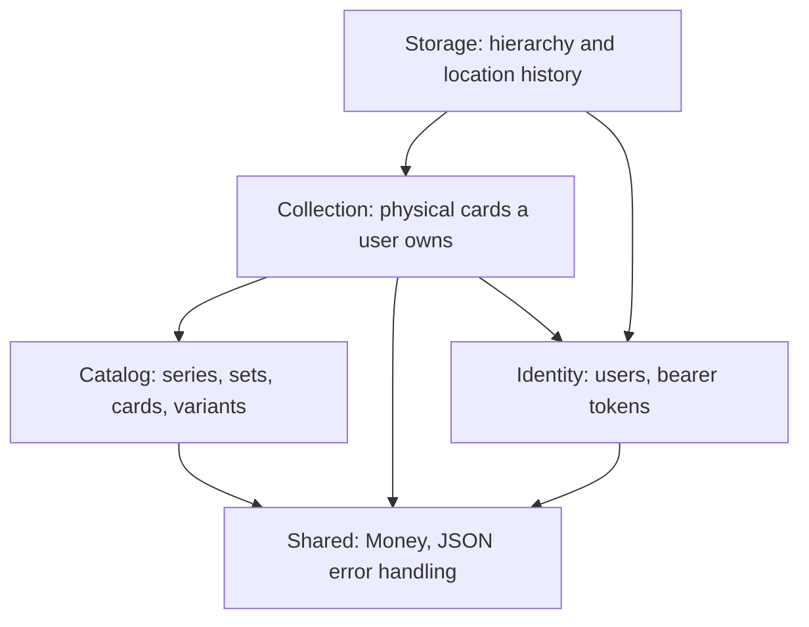

# CardNest

CardNest is a collection-management platform and marketplace for trading cards. It is being built as a **modular
monolith** from a detailed product specification, one module at a time, rather than generated all at once. "CardNest"
is a working title; the codebase deliberately avoids trademarked names in its domain model (`CatalogCard`, `CardSet`,
`CollectionItem`, ...) so the platform is never tied to a specific card brand at the code level, even though the
first release targets Pokémon-style trading cards.

## What problem does it solve?

Collectors currently spread the same information across many disconnected tools: one app for their collection, a
spreadsheet for purchase prices, another site for current values, a marketplace for selling, phone photos as
condition proof, and a note for missing cards. CardNest's core idea is:

> Every physical card is registered exactly once, as a single, unique digital object.

From that one registration, the same physical card can be added to a collection, placed in a binder or storage box,
flagged as a duplicate, put on a wishlist, listed for sale, sold, and tracked through its full price and ownership
history — without ever re-entering its details.

## Who it's for

The first release targets private Pokémon card collectors in the Netherlands and Belgium who collect individual
cards, chase full sets, buy and sell, store their cards in binders/boxes/top loaders, and want one place to see what
they own, where it physically is, and what it's worth. Professional sellers, card shops, graded-card collectors, and
other TCGs are explicitly out of scope for this first release.

## What you can do today

CardNest is implemented incrementally, one module at a time. This is the current state of the project:

### Accounts (Identity module)

- Register with e-mail and password (strength and confirmation validated server-side)
- Log in and receive a revocable bearer token (only a SHA-256 hash is stored; tokens expire after 30 days)
- Log out, which immediately revokes the token
- E-mail verification is modeled end-to-end — queued asynchronously through Symfony Messenger behind an
  `EmailVerificationSender` interface — but the development adapter only logs the message, so no real mail provider
  is required yet
- Login attempts are rate-limited per e-mail + IP address (5 attempts per minute)

### Card catalog (Catalog module)

- Browse card series and sets (`GET /api/v1/card-sets`), each with release date, language, printed/total card
  counts, and lifecycle status (announced, active, out of print, unknown)
- Search the catalog (`GET /api/v1/cards`) filtered by set, name, card number, or rarity, with pagination
- Look up a single set or card in full detail, including every variant it was printed in (holo, reverse holo,
  illustration rare, ...) drawn from a closed, configurable vocabulary instead of free text
- Every catalog card keeps, and exposes, a record of the external source(s) it was imported from (source name,
  external id, last sync date), so a future import adapter can refresh data without silently overwriting manual
  corrections
- Catalog data is intentionally public and read-only. It describes what a card officially *is* — never who owns one
- Seed data ships two real-shaped sets and twenty cards for local exploration, including the "Mudkip 19/25" example
  used throughout the product specification

### Your collection (Collection module)

- Register one or more physical copies of a catalog card in a single call — pick the variant, language, and
  condition, plus optional purchase price/date, seller and notes. Asking for `quantity: 3` creates three separate
  physical-card records, never a single row with a counter, because each copy can later diverge (different sale,
  different binder slot, different condition over time)
- Search and page through your own collection, filtered by card, set, name, number, language, variant, condition or
  status
- Update any detail later, or archive a card (a soft removal that keeps its history instead of deleting it)
- Automatic duplicate detection: every item reports how many of your **in-collection** copies share the same card,
  language and variant
- Strict ownership checks: your collection is only ever visible to you, and a wrong or foreign id behaves exactly
  like it doesn't exist
- On the frontend, a full "My collection" page ties this together: search the catalog, add a card with all its
  details, filter/paginate in a grid or list view, edit an item and its physical location in a modal, and archive it

### Physical storage (Storage module)

- Create and reorganize owner-scoped hierarchical locations such as a room, cabinet, box, display, or safe
- Assign a physical collection item to exactly one current location, then move or unplace it later
- Keep every previous placement in an immutable location history with placed/removed timestamps
- Enforce the single-current-location rule with a partial unique PostgreSQL index and pessimistic locking
- Automatically close a current placement when its collection item is archived
- Build and edit the hierarchy in a dedicated authenticated storage page

### Frontend

- Vue 3 + TypeScript single-page app: registration, login, dashboard, collection, and storage pages behind a route
  guard
- A small hand-rolled component layer (button, input, error message) instead of a full UI kit
- A typed API client with structured error handling, a Pinia store for authentication state, and small utilities
  (e.g. money formatting for minor-unit amounts)

### Platform

- Dockerized backend (PHP / Symfony), frontend, PostgreSQL, and Redis
- A `/api/v1/health` endpoint for uptime checks
- Structured JSON error responses (`{"error": {"code", "message", "details"}}`) across the whole API
- Continuous integration that runs the backend and frontend test suites on every push

The full HTTP contract is documented in [docs/api.md](docs/api.md).

## What's not built yet

Everything below belongs to the product specification but is intentionally not implemented yet. Each will land as
its own module, in roughly this order:

- **Binder** — visual binder pages/slots, drag-and-drop placement, and placeholders for missing cards in an
  incomplete set
- **Wishlist** — tracking wanted cards per set/variant/condition/price and auto-matching them against purchases
- **Marketplace, Order & Payment** — listings, shopping cart and checkout, temporary stock reservations, a fake
  payment provider for development, and the full order lifecycle
- **Shipping, Review, Notification, Pricing, Moderation, Reporting** — supporting modules around the above
  (shipment tracking, buyer/seller reviews, price history, fraud signals, financial reporting, ...)

Trading, real payments, auctions, price negotiation, automated card scanning, grading submissions, sealed products,
and international shipping are explicitly out of scope for the MVP described in the product specification.

## Guiding principles

A few rules carry through every module built so far, and are meant to hold for every module still to come:

- Register a physical card once, then reuse that registration everywhere: collection, binder, wishlist, listing,
  sale, and financial history.
- The backend is always the source of truth. The frontend never enforces a business rule on its own.
- Money is always an integer amount plus a currency code, never a floating-point number.
- Every endpoint checks object ownership, not just the caller's role — a regular user can only ever touch their own
  data, and a foreign id returns "not found" rather than "forbidden".
- Catalog data (what a card *is*) and collection data (what a specific user *owns*) are strictly separate concepts,
  modeled as different entities in different modules.

## Architecture

CardNest is a **modular monolith**, not a set of microservices. Each module lives under `backend/src/<Module>` and
is internally layered the same way:

```text
backend/src/<Module>/
  Domain/          entities, value objects, and repository interfaces — no framework code
  Application/     use cases plus request/response DTOs
  Infrastructure/  Doctrine repositories, adapters, and fixtures
  Presentation/    HTTP controllers
```

Doctrine entities never cross the API boundary: controllers only ever return explicit response DTOs. Repository
interfaces live in `Domain`; their Doctrine-backed implementations live in `Infrastructure` and are wired together
in `config/services.yaml`, so persistence details can change without touching business logic.



Implemented modules today: `Identity`, `Catalog`, `Collection`, `Storage`, `Shared`. Planned modules follow the same
shape (see "What's not built yet" above). For a deeper walkthrough — including a request-sequence diagram and the
conventions every module follows — see [docs/architecture.md](docs/architecture.md).

## Tech stack

| Layer | Choice |
| --- | --- |
| Backend | PHP 8.4, Symfony 7.4 (LTS), Doctrine ORM, Symfony Messenger/Security/Validator |
| Frontend | Vue 3 (Composition API, `<script setup>`), TypeScript (strict mode), Vite, Vue Router, Pinia |
| Database | PostgreSQL — relational columns for filterable/sortable data, `jsonb` only for source-specific metadata |
| Cache & queue | Redis, via Symfony Messenger |
| Testing | PHPUnit, PHPStan (level 8), PHP-CS-Fixer, Vitest, Playwright |
| Infrastructure | Docker Compose, GitHub Actions |

## Project layout

```text
cardnest/
  backend/     Symfony JSON API (see backend/src for the module breakdown above)
  frontend/    Vue 3 + TypeScript single-page app
  docker/      Dockerfiles for the backend and frontend images
  docs/        API contract and architecture reference
  compose.yaml Local multi-service Docker Compose stack
```

## Learn more

- [docs/api.md](docs/api.md) — the full HTTP contract, request/response shapes, and error codes
- [docs/architecture.md](docs/architecture.md) — system diagram, module layering, and an end-to-end request walkthrough
- [CONTRIBUTING.md](CONTRIBUTING.md) — ground rules, coding standards, and the workflow for adding the next module
- [frontend/README.md](frontend/README.md) — frontend structure, API-client conventions, and how to add a page
