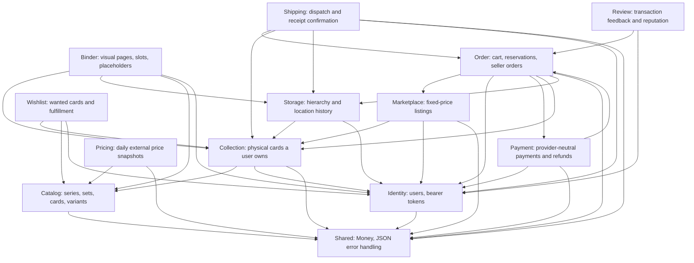

# CardNest

CardNest is a collection-management platform and marketplace for trading cards. It is being built as a **modular
monolith** from a detailed product specification, one module at a time, rather than generated all at once. "CardNest"
is a working title; the codebase deliberately avoids trademarked names in its domain model (`CatalogCard`, `CardSet`,
`CollectionItem`, ...) so the platform is never tied to a specific card brand at the code level, even though the
first release targets Pokémon-style trading cards.

## What problem does it solve?

Collectors currently spread the same information across many disconnected tools: one app for their collection, a
spreadsheet for purchase prices, another site for current values, a marketplace for selling, phone photos as
condition proof, and a note for missing cards. CardNest's core idea is:

> Every physical card is registered exactly once, as a single, unique digital object.

From that one registration, the same physical card can be added to a collection, placed in a binder or storage box,
flagged as a duplicate, put on a wishlist, listed for sale, sold, and tracked through its full price and ownership
history — without ever re-entering its details.

## Who it's for

The first release targets private Pokémon card collectors in the Netherlands and Belgium who collect individual
cards, chase full sets, buy and sell, store their cards in binders/boxes/top loaders, and want one place to see what
they own, where it physically is, and what it's worth. Professional sellers, card shops, graded-card collectors, and
other TCGs are explicitly out of scope for this first release.

## What you can do today

CardNest is implemented incrementally, one module at a time. This is the current state of the project:

### Accounts (Identity module)

- Register with e-mail and password (strength and confirmation validated server-side)
- Log in and receive a revocable bearer token (only a SHA-256 hash is stored; tokens expire after 30 days)
- Log out, which immediately revokes the token
- E-mail verification is modeled end-to-end — queued asynchronously through Symfony Messenger behind an
  `EmailVerificationSender` interface — but the development adapter only logs the message, so no real mail provider
  is required yet
- Login attempts are rate-limited per e-mail + IP address (5 attempts per minute)

### Card catalog (Catalog module)

- Browse card series and sets (`GET /api/v1/card-sets`), each with release date, language, printed/total card
  counts, and lifecycle status (announced, active, out of print, unknown)
- Search the catalog (`GET /api/v1/cards`) filtered by set, series, name, card number, rarity, or variant, with pagination
- Look up a single set or card in full detail, including every variant it was printed in (holo, reverse holo,
  illustration rare, ...) drawn from a closed, configurable vocabulary instead of free text
- Import official set and card data from TCGdex through a provider adapter. The import is resumable and idempotent:
  it retains the source name, external id and raw provider payload, refreshes that raw data on a later run, and keeps
  manual source corrections separate
- Catalog data is intentionally public and read-only. It describes what a card officially *is* — never who owns one
- Seed data ships two real-shaped sets and twenty cards for local exploration, including the "Mudkip 19/25" example
  used throughout the product specification

### Your collection (Collection module)

- Register one or more physical copies of a catalog card in a single call — pick the variant, language, and
  condition, plus optional purchase price/date, seller and notes. Asking for `quantity: 3` creates three separate
  physical-card records, never a single row with a counter, because each copy can later diverge (different sale,
  different binder slot, different condition over time)
- Search and page through your own collection, filtered by card, set, name, number, language, variant, condition or
  status
- Update any detail later, or archive a card (a soft removal that keeps its history instead of deleting it)
- Automatic duplicate detection: every item reports how many of your non-archived copies share the same card,
  language and variant, including copies currently offered for sale
- Strict ownership checks: your collection is only ever visible to you, and a wrong or foreign id behaves exactly
  like it doesn't exist
- On the frontend, a full "My collection" page ties this together: search the catalog, add a card with all its
  details, filter/paginate in a grid or list view, edit an item and its physical location in a modal, and archive it

### Physical storage (Storage module)

- Create and reorganize owner-scoped hierarchical locations such as a room, cabinet, box, display, or safe
- Assign a physical collection item to exactly one current location, then move or unplace it later
- Keep every previous placement in an immutable location history with placed/removed timestamps
- Enforce the single-current-location rule with a partial unique PostgreSQL index and pessimistic locking
- Automatically close a current placement when its collection item is archived
- Build and edit the hierarchy in a dedicated authenticated storage page

### Visual binders (Binder module)

- Create configurable 2×2, 3×3, 4×3, or custom binders with single- or double-sided physical pages
- Browse every page as a visual grid and place physical collection items by drag-and-drop or an accessible
  click-to-select flow
- Reserve a slot for a missing catalog card, add a manual placeholder, or clear it again
- Move an item atomically between storage locations and binder slots while preserving one continuous placement
  history
- Prevent two cards from occupying the same slot and reject cards that do not match a catalog-card reservation
- Keep binder data private to its owner; foreign binder, slot, location, and collection-item identifiers are hidden
  behind the same owner-safe not-found behavior

### Wishlists (Wishlist module)

- Create, rename, browse, and remove multiple private wishlists
- Add catalog cards with optional language, variant, minimum condition, maximum EUR price, desired quantity,
  priority, and notes
- Track desired, fulfilled, and remaining quantities for the whole wishlist and per card set
- Count matching cards already in the collection when a goal is added
- Automatically fulfill matching wishlist quantities whenever new physical collection items are registered, while
  retaining the original target quantity and completion timestamp
- Remove individual goals without affecting the catalog card or any physical collection item

### Marketplace listings (Marketplace module)

- Create a fixed-price draft directly from one owned physical `CollectionItem`; catalog, variant, language and
  condition data are reused instead of entered again
- Require an HTTPS front and back photo reference plus at least one Dutch/Belgian MVP delivery option: letter mail,
  parcel or free pickup. Direct S3-compatible uploads are a separate upcoming storage increment
- Publish and cancel through a Symfony Workflow state machine. Publishing marks the physical item `for_sale`, while
  cancellation or expiration returns it to `in_collection`
- Enforce one blocking listing per physical item in PostgreSQL, even when concurrent requests race
- Search active public listings by card, set, number, language, variant, condition, price and delivery option;
  every option exposes item price, delivery price and the complete total up front
- Keep an immutable price history and seller-only physical-item reference without exposing that private identifier
  in public responses
- Schedule optional expiration through Redis-backed Symfony Messenger; an idempotent worker closes the listing and
  releases its physical card when the end time arrives

### Cart, checkout and delivery (Order + Payment + Shipping modules)

- Add active listings from multiple sellers to one private cart; duplicate entries and buying your own listing are
  rejected by the backend
- Group cards per seller and expose only delivery methods supported by every card in that group. Combined postage is
  the highest configured price for the selected method, never an unexplained per-card sum
- Lock the cart and every listing in a deterministic order during checkout, so competing buyers cannot purchase the
  same physical card and a failure rolls the entire checkout back
- Split one checkout into one immutable order per seller while keeping one shared payment and an address snapshot
  per order; all amounts remain integer EUR minor units
- Use a replaceable `PaymentProvider` interface with a fake development adapter that succeeds immediately and never
  asks for or stores card or bank details
- Keep completed reservation and payment-transaction records for traceability, and expose only orders in which the
  caller is the buyer or seller
- Let either order participant cancel a `pending_payment` or unshipped `paid` order with a required, stored reason;
  every cancellation is protected by an owner-safe `404`, an order lock, and immutable status history
- Refund a paid order for its immutable order total only. A `Refund` and immutable refund payment transaction are
  linked to that seller order, so a shared checkout payment remains `succeeded` while any funded order is paid or
  completed
- Cancel the sold listing without republishing it and return its seller-owned physical item to `in_collection` when
  cancellation and its fake-provider refund succeed together
- Let only the seller move a paid order to `shipped` and only the buyer confirm receipt; each command locks the
  order and validates the Symfony Workflow transition inside one database transaction
- Keep an immutable actor-stamped order-status history plus a one-per-order shipment record with shipped and
  delivered timestamps
- On confirmed receipt, archive the seller's sold physical collection items and close their current storage or
  binder placements atomically while retaining the full location and sale history
- Offer each completed order item to the buyer exactly once: card, variant and paid item price are reused from the
  order, while the buyer confirms language, received condition, notes and an optional owner-checked storage location

### Reviews and reputation (Review module)

- Let both participants review the other participant after an order is completed, with one immutable review per
  participant and order
- Capture an overall score plus description accuracy, packaging, communication and shipping speed on fixed 1–5
  scales, with an optional comment
- Derive the reviewed user from the authenticated participant and order instead of trusting a caller-supplied user id
- Serialize concurrent review attempts with an order lock and enforce uniqueness, distinct users, score ranges and
  comment length again in PostgreSQL
- Expose authored reviews privately and a paginated public reputation summary without disclosing transaction ids

### Daily market prices (Pricing module)

- Show Cardmarket EUR price indications on every catalog-card detail page: lowest listed price, average source
  price and trend price, split into standard/non-foil and holo/foil when the source provides both
- Fetch the current TCGdex card response at most once per card per Amsterdam calendar day and store exact integer
  eurocent snapshots; a shared Redis lock prevents concurrent page and scheduler requests from duplicating that call
- Keep daily history with both CardNest's observation time and the provider's own update time, including the trend
  difference from the previous stored day
- Refresh cards in open wishlists, active collections and non-terminal listings automatically every day at 12:00
  Europe/Amsterdam through Symfony Scheduler and the Redis-backed Messenger queue
- Keep the market-price provider behind an interface and label values as an external indication, never as a
  guaranteed market value or sale result. Missing source pricing remains an explicit no-data state and temporary
  source failures use a five-minute retry cooldown

### Frontend

- Vue 3 + TypeScript single-page app: a public marketplace and reputation profiles plus authenticated registration,
  login, dashboard, collection, storage, visual binder, wishlist, seller-listing, cart, checkout and order pages
- A small hand-rolled component layer (button, input, error message) instead of a full UI kit
- A typed API client with structured error handling, a Pinia store for authentication state, and small utilities
  (e.g. money formatting for minor-unit amounts)

### Platform

- Dockerized backend (PHP / Symfony), frontend, PostgreSQL, Redis, a Messenger worker, and a dedicated pricing
  scheduler worker
- A `/api/v1/health` endpoint for uptime checks
- Structured JSON error responses (`{"error": {"code", "message", "details"}}`) across the whole API
- Continuous integration that runs the backend and frontend test suites on every push

The full HTTP contract is documented in [docs/api.md](docs/api.md).

## Planning and contribution

Delivery is tracked in the private [CardNest Development GitHub Project](https://github.com/users/Jelmer-Ketelaar/projects/7).
It contains the ordered MVP roadmap, milestones, epics, dependencies, sizing and priority metadata. See the
[product vision](docs/product-vision.md), [development workflow](docs/development-workflow.md) and
[GitHub Project guide](docs/github-project.md) before selecting work.

## What's not built yet

Everything below belongs to the product specification but is intentionally not implemented yet. Each will land as
its own module, in roughly this order:

- **Notification** — delivery updates and other transactional alerts
- **Pricing, Moderation, Reporting** — supporting modules around the marketplace
- **Disputes for shipped or completed orders, a real payment provider, partial item refunds, and chargebacks** —
  financial and operational paths beyond the synchronous fake-provider cancellation flow
  (alerts, price history, fraud signals, financial reporting, ...)
- **Cancellations and refunds** — add reversible post-payment failure paths separately from successful fulfillment
- **Notification, Moderation, Reporting** — supporting modules around the marketplace
  (alerts, fraud signals, financial reporting, ...)

Trading, real payments, auctions, price negotiation, automated card scanning, grading submissions, sealed products,
and international shipping are explicitly out of scope for the MVP described in the product specification.

## Guiding principles

A few rules carry through every module built so far, and are meant to hold for every module still to come:

- Register a physical card once, then reuse that registration everywhere: collection, binder, wishlist, listing,
  sale, and financial history.
- The backend is always the source of truth. The frontend never enforces a business rule on its own.
- Money is always an integer amount plus a currency code, never a floating-point number.
- Every endpoint checks object ownership, not just the caller's role — a regular user can only ever touch their own
  data, and a foreign id returns "not found" rather than "forbidden".
- Catalog data (what a card *is*) and collection data (what a specific user *owns*) are strictly separate concepts,
  modeled as different entities in different modules.

## Architecture

CardNest is a **modular monolith**, not a set of microservices. Each module lives under `backend/src/<Module>` and
is internally layered the same way:

```text
backend/src/<Module>/
  Domain/          entities, value objects, and repository interfaces — no framework code
  Application/     use cases plus request/response DTOs
  Infrastructure/  Doctrine repositories, adapters, and fixtures
  Presentation/    HTTP controllers
```

Doctrine entities never cross the API boundary: controllers only ever return explicit response DTOs. Repository
interfaces live in `Domain`; their Doctrine-backed implementations live in `Infrastructure` and are wired together
in `config/services.yaml`, so persistence details can change without touching business logic.



Implemented modules today: `Identity`, `Catalog`, `Collection`, `Storage`, `Binder`, `Wishlist`, `Marketplace`,
`Order`, `Payment`, `Shipping`, `Review`, `Pricing`, `Shared`. Planned modules follow the same shape (see "What's not built
yet" above).
For a deeper walkthrough — including a
request-sequence diagram and the conventions every module follows — see [docs/architecture.md](docs/architecture.md).

## Tech stack

| Layer | Choice |
| --- | --- |
| Backend | PHP 8.4, Symfony 7.4 (LTS), Doctrine ORM, Symfony Messenger/Security/Validator/Workflow |
| Frontend | Vue 3 (Composition API, `<script setup>`), TypeScript (strict mode), Vite, Vue Router, Pinia |
| Database | PostgreSQL — relational columns for filterable/sortable data, `jsonb` only for source-specific metadata |
| Cache & queue | Redis, via Symfony Messenger |
| Testing | PHPUnit, PHPStan (level 8), PHP-CS-Fixer, Vitest, Playwright |
| Infrastructure | Docker Compose, GitHub Actions |

## Project layout

```text
cardnest/
  backend/     Symfony JSON API (see backend/src for the module breakdown above)
  frontend/    Vue 3 + TypeScript single-page app
  docker/      Dockerfiles for the backend and frontend images
  docs/        API contract and architecture reference
  compose.yaml Local multi-service Docker Compose stack
```

## Run locally

Requirements: Docker Engine with Docker Compose. PHP, Composer, Node.js, PostgreSQL, and Redis do not need to be
installed on the host.

```bash
cp .env.example .env
docker compose build
docker compose run --rm --no-deps backend composer install
docker compose up
```

The frontend is then available at <http://localhost:5174> and the API at <http://localhost:8080/api/v1>. The backend
container applies outstanding migrations on startup; the `worker` container consumes asynchronous jobs and the
`pricing-scheduler` container emits the daily refresh at noon (Europe/Amsterdam). To load the optional twenty-card
development catalog into an empty database:

```bash
docker compose exec backend php bin/console doctrine:fixtures:load --no-interaction
```

Refresh one card immediately, or omit the UUID to refresh all currently followed cards:

```bash
docker compose exec backend php bin/console pricing:refresh <catalog-card-uuid> --force
docker compose exec backend php bin/console pricing:refresh
docker compose exec backend php bin/console debug:scheduler pricing
```

### Import the full catalog

The catalog importer uses the [TCGdex v2 API](https://tcgdex.dev/rest) behind a `CardCatalogProvider` adapter. Without
options it imports every language the provider currently declares, every available set, and every available card:

```bash
docker compose exec backend php bin/console --no-debug catalog:import:tcgdex
```

TCGdex image bases are resolved to external `high.webp` detail images and `low.webp` thumbnails as documented by
the provider; CardNest does not download or store those protected card images locally.

This is intentionally a long-running, resumable operation. For a small validation run, target a language and set;
running the same command again does not create duplicates:

```bash
docker compose exec backend php bin/console catalog:import:tcgdex --language=en --set=base1
```

The standard run imports the complete set/card index needed for browsing and wishlists with one source request per
set. To enrich those same records with the full per-card source payload (rarity, card type, detailed variants,
illustrator and similar data), run a later, slower pass:

```bash
docker compose exec backend php bin/console --no-debug catalog:import:tcgdex --with-card-details
```

TCGdex publishes different levels of coverage per language. CardNest imports every record the source provides, but
does not invent records missing upstream. The importer only saves source-provided external image URLs; it does not
download or locally cache card artwork. Review the image/data source terms before enabling this import in production.

`CART_RESERVATION_MINUTES` defaults to `15` and accepts `1`–`60`. It defines the reservation expiry recorded during
checkout; the current fake provider succeeds synchronously, so those reservations complete immediately.

Run the main quality checks with:

```bash
docker compose exec backend vendor/bin/phpunit
docker compose exec backend vendor/bin/phpstan analyse --no-progress --memory-limit=512M
docker compose exec backend vendor/bin/php-cs-fixer fix --dry-run --diff
docker compose exec frontend npm run lint
docker compose exec frontend npm test
docker compose exec frontend npm run build
docker compose exec frontend npm run test:e2e
```

## Learn more

- [docs/api.md](docs/api.md) — the full HTTP contract, request/response shapes, and error codes
- [docs/architecture.md](docs/architecture.md) — system diagram, module layering, and an end-to-end request walkthrough
- [docs/security-review.md](docs/security-review.md) — repeatable MVP security release gate and evidence template
- [docs/release-checklist.md](docs/release-checklist.md) — MVP quality, security, accessibility and deployment release gate
- [docs/production-environment.md](docs/production-environment.md) — production configuration and operational expectations
- [docs/release-notes/mvp.md](docs/release-notes/mvp.md) — delivered MVP scope and explicit limitations
- [CONTRIBUTING.md](CONTRIBUTING.md) — ground rules, coding standards, and the workflow for adding the next module
- [frontend/README.md](frontend/README.md) — frontend structure, API-client conventions, and how to add a page
