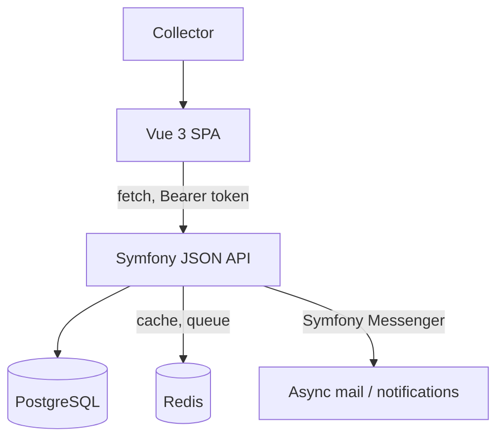
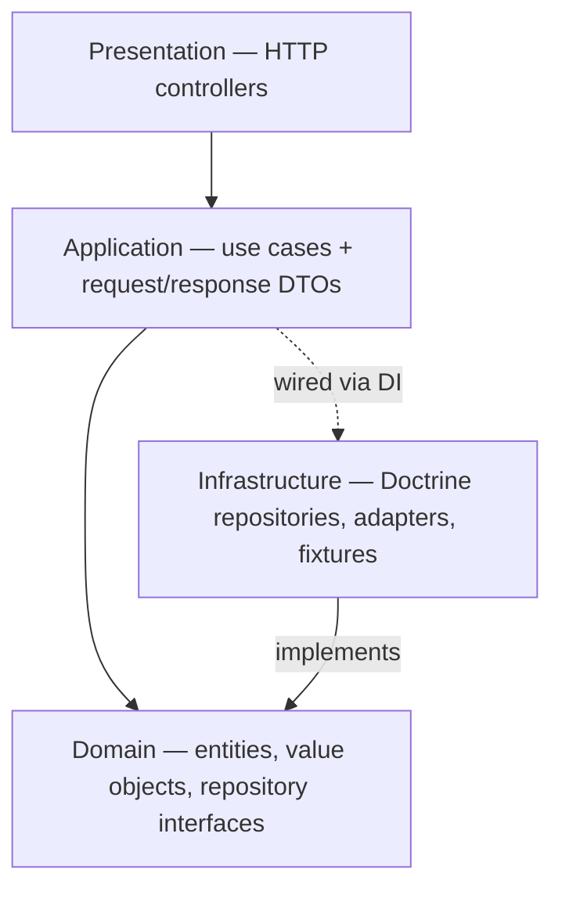
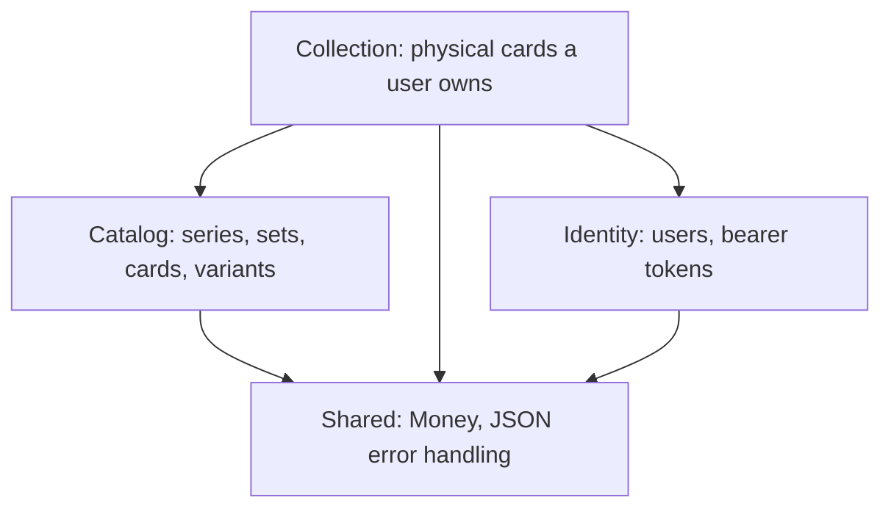
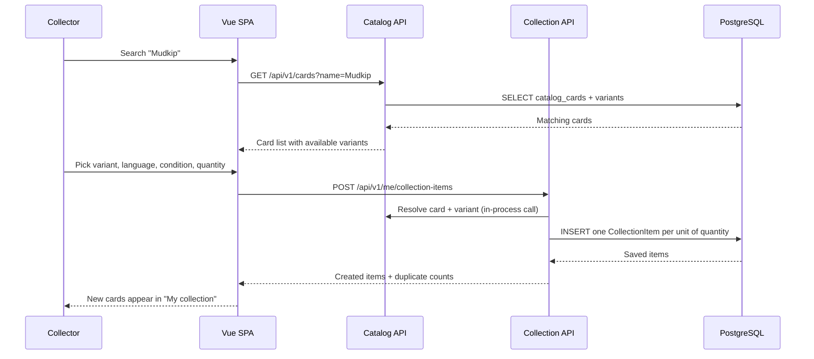

# Architecture

CardNest is a **modular monolith**: one Symfony deployable, internally split into modules that each own their own
data and only talk to each other through explicit interfaces. There are no microservices, no shared database access
across module boundaries, and no network hops between modules.

## System context

The frontend never talks to Postgres or Redis directly, and it never encodes a business rule — it calls the API and
renders what comes back. The API is the single source of truth.

## Layering inside a module

Every module (`backend/src/<Module>`) is sliced the same way, inspired by ports-and-adapters:

- **Domain** has no framework dependency beyond Doctrine mapping attributes on entities. It defines repository
  *interfaces*, never their implementation, plus enums for closed vocabularies (e.g. `VariantCode`, `CardCondition`)
  and small value objects (e.g. `Money`).
- **Application** contains one class per use case (`CreateCollectionItems`, `ArchiveCollectionItem`, ...) plus the
  request/response DTOs for that module. It depends only on `Domain` interfaces, never on `Infrastructure` classes
  directly.
- **Infrastructure** implements those interfaces with Doctrine (`DoctrineCollectionItemRepository`, ...) and holds
  anything else that talks to the outside world (fixtures, future import adapters, mail senders).
- **Presentation** is thin HTTP controllers: map the request to a DTO, call one Application service, return its
  response DTO as JSON. No business logic lives here.

`config/services.yaml` binds each `Domain` repository interface to its `Infrastructure` implementation, so swapping
persistence technology later never touches `Domain` or `Application` code. Controllers never return Doctrine
entities directly — every HTTP response is built from an explicit `*Response` DTO's `toArray()`.

## Modules today

| Module | Owns | Depends on |
| --- | --- | --- |
| `Identity` | `users`, `auth_tokens` | `Shared` |
| `Catalog` | `card_series`, `card_sets`, `catalog_cards`, `card_variants`, `card_external_references` | `Shared` |
| `Collection` | `collection_items` | `Catalog` (which card/variant), `Identity` (owner), `Shared` (`Money`) |
| `Shared` | cross-cutting value objects and the API exception handler | — |

Planned modules (`Storage`, `Binder`, `Wishlist`, `Marketplace`, `Order`, `Payment`, `Shipping`, `Review`,
`Notification`, `Pricing`, `Moderation`, `Reporting`) will slot in the same way, each adding one more layer of
dependency on `Catalog`/`Collection`/`Identity` without those lower modules ever depending back up.

`App\Shared\Infrastructure\Http\JsonExceptionSubscriber` is the one place that turns a thrown domain/application
exception into a structured HTTP error response (status code + machine-readable `code` + message). Every module adds
its own `match` arms there instead of formatting errors itself.

## Example flow: registering a physical card

This walks through the concrete request sequence behind "search a card, then add a physical copy to your
collection" — the interaction that makes CardNest's core idea (register a card once, reuse it everywhere) concrete.

`Collection` calls into `Catalog`'s repository interface directly (an in-process PHP call, not an HTTP request) to
resolve `catalogCardId`/`variantId` before creating any `CollectionItem`, and rejects the request with a `422` if
either doesn't exist. This is also why `quantity: 3` results in three rows in the sequence above instead of one row
with a counter: the same physical card can later be split across a sale, a binder slot, and a wishlist match, each
of which only makes sense per individual copy.

## Data conventions that hold across every module

- **Identifiers**: UUIDv7 everywhere a record is publicly addressable, generated in the entity constructor.
- **Money**: always `App\Shared\Domain\ValueObject\Money` — an integer amount in minor units plus an ISO currency
  code. Never a float, in the database or in application code.
- **Closed vocabularies over free text**: languages, conditions, card variants and lifecycle statuses are backed
  PHP enums mapped with Doctrine's `enumType`, not `varchar` columns a caller can put anything into.
- **`jsonb` is for source-specific metadata only** (raw import payloads, external references) — anything that is
  filtered, sorted or validated on gets a real relational column instead.
- **Migrations are generated, not hand-written**: entity mapping attributes are the source of truth, and
  `doctrine:migrations:diff` produces the SQL, which is then reviewed (and check constraints added) by hand before
  committing.

See [docs/api.md](api.md) for the resulting HTTP contract and [../CONTRIBUTING.md](../CONTRIBUTING.md) for the
workflow used to add the next module.
