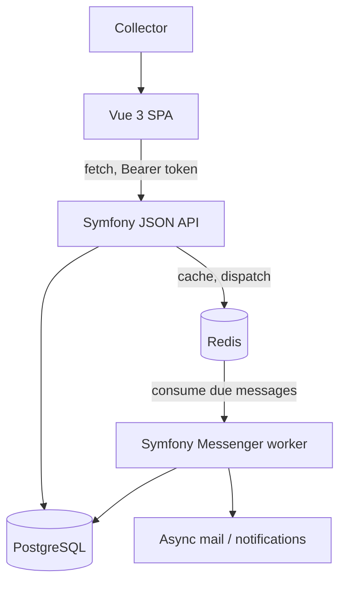
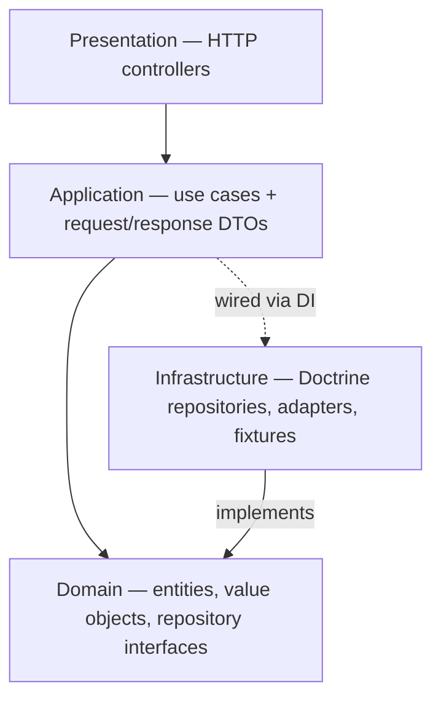
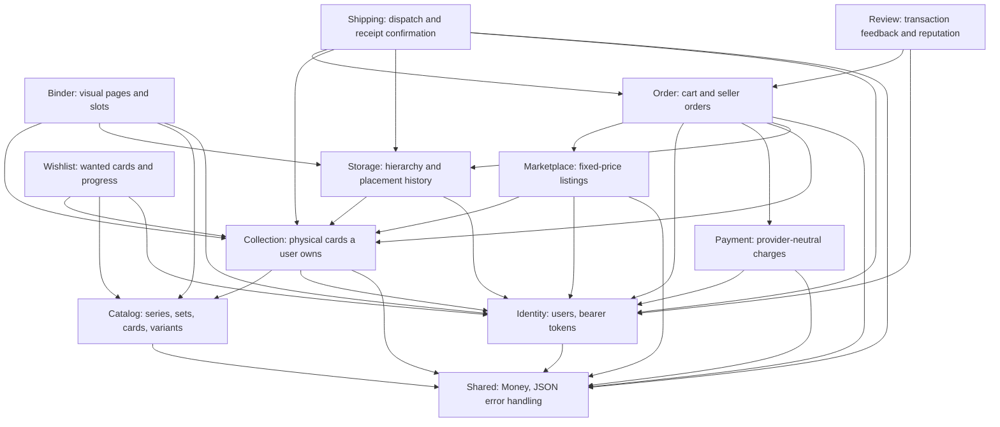
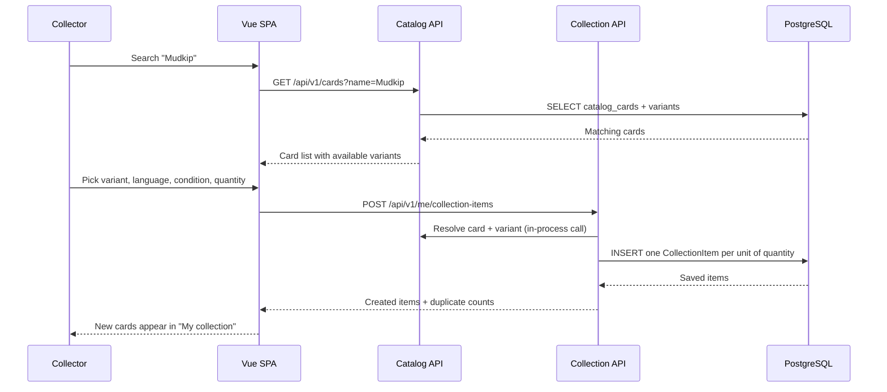
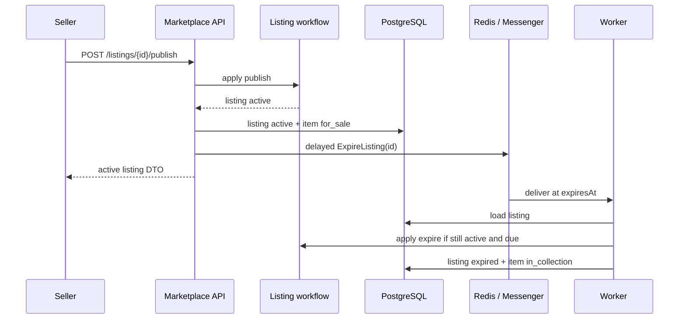

# Architecture

CardNest is a **modular monolith**: one Symfony deployable, internally split into modules that each own their own
data and only talk to each other through explicit interfaces. There are no microservices, no shared database access
across module boundaries, and no network hops between modules.

## System context



The frontend never talks to Postgres or Redis directly, and it never encodes a business rule — it calls the API and
renders what comes back. The API is the single source of truth.

## Layering inside a module

Every module (`backend/src/<Module>`) is sliced the same way, inspired by ports-and-adapters:



- **Domain** has no framework dependency beyond Doctrine mapping attributes on entities. It defines repository
  *interfaces*, never their implementation, plus enums for closed vocabularies (e.g. `VariantCode`, `CardCondition`)
  and small value objects (e.g. `Money`).
- **Application** contains one class per use case (`CreateCollectionItems`, `ArchiveCollectionItem`, ...) plus the
  request/response DTOs for that module. It depends on `Domain` interfaces and injected Symfony abstractions such as
  Messenger or Workflow, never on a module's concrete `Infrastructure` classes directly.
- **Infrastructure** implements those interfaces with Doctrine (`DoctrineCollectionItemRepository`, ...) and holds
  anything else that talks to the outside world (fixtures, future import adapters, mail senders).
- **Presentation** is thin HTTP controllers: map the request to a DTO, call one Application service, return its
  response DTO as JSON. No business logic lives here.

`config/services.yaml` binds each `Domain` repository interface to its `Infrastructure` implementation, so swapping
persistence technology later never touches `Domain` or `Application` code. Controllers never return Doctrine
entities directly — every HTTP response is built from an explicit `*Response` DTO's `toArray()`.

## Modules today



| Module | Owns | Depends on |
| --- | --- | --- |
| `Identity` | `users`, `auth_tokens` | `Shared` |
| `Catalog` | `card_series`, `card_sets`, `catalog_cards`, `card_variants`, `card_external_references` | `Shared` |
| `Collection` | `collection_items` | `Catalog` (which card/variant), `Identity` (owner), `Shared` (`Money`) |
| `Storage` | `storage_locations`, `collection_item_location_history` | `Collection` (physical item), `Identity` (owner) |
| `Binder` | `binders`, `binder_pages`, `binder_slots` | `Collection` (placement), `Storage` (history/parent), `Catalog` (reserved card), `Identity` (owner) |
| `Wishlist` | `wishlists`, `wishlist_items` | `Catalog` (wanted card/variant), `Collection` (matching physical items), `Identity` (owner), `Shared` (`Money`) |
| `Marketplace` | `listings`, `listing_images`, `listing_shipping_methods`, `listing_price_history`, `listing_reservations` | `Collection` (physical item), `Identity` (seller/buyer), `Shared` (`Money`) |
| `Order` | `shopping_carts`, `shopping_cart_items`, `orders`, `order_items`, `order_addresses`, `order_status_history`; one-time buyer collection import | `Marketplace` (listing/reservation), `Payment`, `Collection` (buyer item/wishlist hook), `Storage` (optional placement), `Identity`, `Shared` |
| `Payment` | `payments`, `payment_transactions`; the `PaymentProvider` port and fake adapter | `Identity` (buyer), `Shared` (`Money`) |
| `Shipping` | `shipments`; seller dispatch, buyer receipt confirmation, and sold-item archival | `Order`, `Collection`, `Storage`, `Identity`, `Shared` |
| `Review` | `reviews`; participant feedback and public aggregate reputation | `Order` (completed transaction), `Identity` (reviewer and reviewed user) |
| `Shared` | cross-cutting value objects, transaction port, and the API exception handler | — |

Planned modules (`Notification`, `Pricing`, `Moderation`, `Reporting`)
will slot in the same way, each adding one more layer of dependency on
`Catalog`/`Collection`/`Identity` without those lower modules ever depending back up.

`App\Shared\Infrastructure\Http\JsonExceptionSubscriber` is the one place that turns a thrown domain/application
exception into a structured HTTP error response (status code + machine-readable `code` + message). Every module adds
its own `match` arms there instead of formatting errors itself.

## Example flow: registering a physical card

This walks through the concrete request sequence behind "search a card, then add a physical copy to your
collection" — the interaction that makes CardNest's core idea (register a card once, reuse it everywhere) concrete.



`Collection` calls into `Catalog`'s repository interface directly (an in-process PHP call, not an HTTP request) to
resolve `catalogCardId`/`variantId` before creating any `CollectionItem`, and rejects the request with a `422` if
either doesn't exist. This is also why `quantity: 3` results in three rows in the sequence above instead of one row
with a counter: the same physical card can later be split across a sale, a binder slot, and a wishlist match, each
of which only makes sense per individual copy.

## Example flow: publishing and expiring a listing



The database partial unique index is the final guard against two blocking listings for one physical card. Delayed
expiration messages intentionally contain only the listing UUID: the handler reloads current state and is therefore
safe when a seller cancels, clears or changes the expiration, or when a message is delivered twice.

## Example flow: atomic multi-seller checkout

```mermaid
sequenceDiagram
    participant Buyer
    participant SPA as Vue SPA
    participant Checkout as Order / CheckoutCart
    participant DB as PostgreSQL
    participant Provider as Fake PaymentProvider

    Buyer->>SPA: Choose shipping per seller + address
    SPA->>Checkout: POST /me/cart/checkout
    Checkout->>DB: BEGIN; lock buyer/cart
    Checkout->>DB: lock listing rows in UUID order
    Checkout->>Checkout: revalidate availability and shipping intersections
    Checkout->>DB: create active reservations, payment and one order/seller
    Checkout->>Provider: charge(PaymentInstruction)
    Provider-->>Checkout: succeeded(fake_reference)
    Checkout->>DB: payment succeeded; orders paid; listings sold; reservations completed; cart cleared
    Checkout->>DB: COMMIT
    Checkout-->>SPA: shared payment + seller orders
    SPA-->>Buyer: Paid orders and transparent totals
```

The buyer row serializes cart creation and mutation even before a cart exists. Listing rows are locked in a stable
UUID order to reduce deadlock risk when two checkouts overlap. All changes, including the provider result, are
persisted through `Shared\Domain\Transaction\TransactionManager`; any exception rolls the unit of work back and
leaves every listing and cart item in its prior state. The provider call is inside this transaction only because the
current adapter is deterministic and local. A real remote provider will require an explicit pending-payment and
idempotent callback/outbox increment rather than holding a database transaction across network I/O.

Cart delivery quotes are server-owned. For one seller, only methods supported by every listing are returned, and
the group price is the maximum configured per-listing amount for that method. The browser submits seller UUID →
method mappings, but checkout recalculates them and rejects missing, extra, or stale choices.

## Example flow: shipping and completing an order

```mermaid
sequenceDiagram
    participant Seller
    participant Buyer
    participant Shipping as Shipping application service
    participant Import as Collection import use case
    participant Workflow as Order workflow
    participant DB as PostgreSQL

    Seller->>Shipping: POST /me/orders/{id}/mark-shipped
    Shipping->>DB: BEGIN; lock seller order
    Shipping->>Workflow: paid → shipped
    Shipping->>DB: append status history + create shipment
    Shipping->>DB: COMMIT
    Shipping-->>Seller: shipped order DTO
    Buyer->>Shipping: POST /me/orders/{id}/confirm-received
    Shipping->>DB: BEGIN; lock buyer order
    Shipping->>Workflow: shipped → completed
    Shipping->>DB: mark shipment delivered
    Shipping->>DB: archive sold items + close current placements
    Shipping->>DB: COMMIT
    Shipping-->>Buyer: completed order DTO
    Buyer->>Import: Confirm language, condition, optional storage
    Import->>DB: BEGIN; lock completed buyer order
    Import->>DB: create buyer item + link order item + fulfill wishlist
    Import->>DB: optionally place in buyer-owned storage
    Import->>DB: COMMIT
    Import-->>Buyer: updated order with imported item id
```

The role-specific repository methods deliberately return not found for the wrong participant, preventing order-id
probing. Both commands validate their workflow transition after acquiring a pessimistic order lock. Completion
then locks sold physical items in deterministic UUID order; the order, shipment, immutable status history, item
archival, and location-history closure therefore either all commit or all roll back. Creating the buyer's new
physical collection item is kept out of this transaction because the buyer must first confirm condition and choose
its destination. The later import locks the same buyer order, derives card, variant, price and purchase date from
the order, and stores the imported collection-item reference directly on the order item. Nullable-pair constraints
keep the reference and timestamp consistent, while the domain rule and order lock make the operation one-time.
The source item remains archived, preserving the seller's acquisition data and closed location history.

## Review consistency and public reputation

`Review\Application\CreateReview` locks the participant-scoped order before checking for an existing review. This
serializes simultaneous attempts by the same participant; a unique `(order_id, reviewer_id)` index remains the
database backstop. The domain entity independently requires a completed order, derives an exact participant pair,
and validates every 1–5 score. The application service determines the reviewed counterparty server-side, so a
caller cannot redirect a valid transaction review to an unrelated account.

Authored-review responses include the order id so the private order UI can suppress a second form. Public
reputation responses use the same response DTO without that field, combine PostgreSQL averages with paginated
reviews, and expose no order or payment references.

## Data conventions that hold across every module

- **Identifiers**: UUIDv7 everywhere a record is publicly addressable, generated in the entity constructor.
- **Money**: always `App\Shared\Domain\ValueObject\Money` — an integer amount in minor units plus an ISO currency
  code. Never a float, in the database or in application code.
- **Closed vocabularies over free text**: languages, conditions, card variants and lifecycle statuses are backed
  PHP enums mapped with Doctrine's `enumType`, not `varchar` columns a caller can put anything into.
- **`jsonb` is for source-specific metadata only** (raw import payloads, external references) — anything that is
  filtered, sorted or validated on gets a real relational column instead.
- **Migrations are generated, not hand-written**: entity mapping attributes are the source of truth, and
  `doctrine:migrations:diff` produces the SQL, which is then reviewed (and check constraints added) by hand before
  committing.

See [docs/api.md](api.md) for the resulting HTTP contract and [../CONTRIBUTING.md](../CONTRIBUTING.md) for the
workflow used to add the next module.
