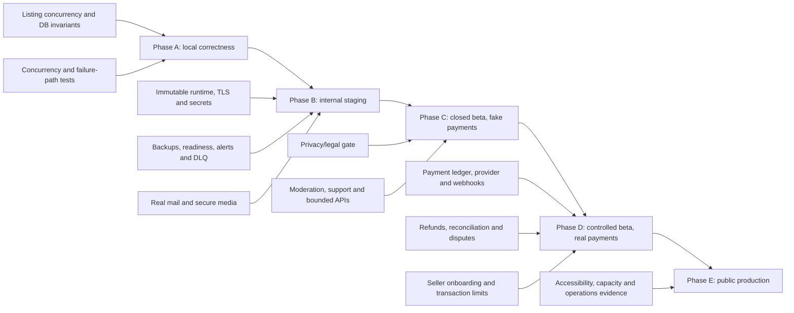

# CardNest production roadmap

Status: proposed roadmap

Audit date: 2026-08-02

Repository baseline: `develop` at `c6935a2`

Overall audit classification: **production-ready for internal testing only**

## 1. Roadmap contract

This roadmap turns the production-readiness audit into gated release phases. It is not a promise of calendar dates. CardNest may advance only when the relevant exit evidence exists in the target environment; completing code without proving deployment, recovery and operations does not satisfy a gate.

Priorities:

- **P0** — blocks a safe release at the phase where the capability becomes applicable, or can cause money/data loss.
- **P1** — required for the first public production release.
- **P2** — important shortly after launch or needed to complete the broader product vision.
- **P3** — future improvement.

Sizes:

- **XS** — a few hours.
- **S** — about one working day.
- **M** — a few working days.
- **L** — about one to two weeks.
- **XL** — too large and must be split before planning.

The proposed backlog contains **17 epics and 52 concrete issues**: **12 P0, 24 P1, 12 P2 and 4 P3**. Every issue is intended to be S or M; epics hold larger outcomes. The canonical issue descriptions and metadata are in `docs/proposed-production-backlog.md`.

### Phase-specific meaning of P0

Several P0 items are conditional release gates:

- A closed beta may use fake payments only when real payment adapters are impossible to select and the UI clearly labels transactions as simulated.
- Provider-neutral payment idempotency and refund/cancellation correctness are still Phase A P0 work; a fake provider is not permission to keep unsafe order state.
- Privacy, image/content safety and identity-delivery P0 items become mandatory before external users are invited.
- Data-integrity, deployment, backup and observability P0 items have no such deferral once persistent external data exists.

No P0 is waived by changing its label. A deferred gate must have an explicit owner, target phase and control that prevents the gated capability from being used prematurely.

## 2. Evidence baseline and release principles

The roadmap starts from a useful local MVP, not from an empty project:

- The modular Symfony/Vue application has working Identity, Catalog, Collection, Storage, Binder, Wishlist, Marketplace, Order, Shipping, Review and Pricing code.
- The audited container suite passed 164 PHPUnit tests (1,318 assertions), PHPStan, Symfony lint, Doctrine schema validation, 77 Vitest tests, the production frontend build and 17 Playwright scenarios.
- Existing Playwright scenarios mock API traffic, so they do not prove browser-to-API-to-PostgreSQL behavior.
- `compose.yaml` runs PHP's and Vite's development servers from bind mounts and starts migrations with the backend. It is a local environment, not a production deployment.
- Production service aliases still select logging-only mail senders and a fake payment provider.
- Checkout locks listings, while cancellation and delayed expiry do not use the same serialization boundary. That stale-write race can leave a paid order pointing at a cancelled or expired listing.
- Seller photos are arbitrary HTTPS references. There is no first-party object-storage, quarantine, MIME/pixel validation, malware scanning or controlled delivery path.
- Backup, restore, monitoring, support, moderation, privacy and legal documents describe intent but are not implemented operational controls.

The release sequence therefore follows five principles:

1. Fix correctness before adding infrastructure around incorrect behavior.
2. Prove an immutable deployment and recovery path before inviting external users.
3. Learn from a fake-payment beta before taking financial risk.
4. Introduce real payments only as an auditable, reconciled lifecycle with seller eligibility, refunds and disputes.
5. Open public registration only after security, compliance, support, capacity and incident gates are evidenced.

## 3. Critical dependency path

The main dependency chains are:

1. Listing serialization → invariant reconciliation → full-stack marketplace tests → fake-payment beta.
2. Runtime images → staging/secrets/TLS → migration job → deployment/rollback evidence.
3. Managed PostgreSQL/Redis/object storage → backup/restore and queue durability → readiness and alerting.
4. Production mail → verified-email enforcement → password recovery → external account invitations.
5. Secure upload ingress → quarantine/scanning → controlled image delivery → collection photos and derivatives.
6. Payment orchestration boundary → attempt ledger → provider adapter → signed idempotent webhooks → reconciliation → limited live payments.
7. Refund transitions + immutable order snapshots → disputes → support procedures → real-money release.
8. Privacy/legal decisions → consent/DSAR controls → retention automation → public registration.

## 4. Release overview

| Phase | Audience | Payments | Primary outcome | Release gate |
|---|---|---|---|---|
| A — Local development complete | Team | Fake only | Correct, reproducible core flows | Local correctness and real full-stack evidence |
| B — Internal staging | Team/testers | Fake only | Deployable, recoverable, observable platform | Production-like infrastructure and operational proof |
| C — Closed beta without real payments | Small allowlist | Explicitly simulated | Validate real collection and marketplace behavior safely | User safety, moderation, privacy and beta stability |
| D — Controlled beta with real payments | Verified buyers/sellers | Limited real transactions | Prove end-to-end financial lifecycle | Reconciliation, refunds, KYC, disputes and legal sign-off |
| E — Public production release | Public NL/BE audience | Real transactions | Operate a scalable, supported marketplace | All P0/P1 gates, capacity, compliance and incident readiness |

## 5. Phase A — Local development complete

### Goal

All scoped MVP behavior works locally, critical state transitions are correct under concurrency, automated checks are trustworthy, and documentation reflects the actual codebase.

### Entry criteria

- The current modular monolith boots through the documented Docker Compose path.
- Dependencies install in the supported PHP 8.4 and Node environments.
- The current migration chain can create and validate a local PostgreSQL schema.
- Feature scope remains limited to the existing MVP; production infrastructure and real payments are not smuggled into this phase.

### Required functionality

- Serialize cancellation and delayed expiry against checkout using one transaction/locking policy (`CN-PROD-001`).
- Make payment initiation idempotent and commit-safe without adding a real provider (`CN-PROD-002`).
- Implement explicit per-order cancellation and refund transitions against the fake provider (`CN-PROD-003`).
- Align `CardLanguage` and wishlist persistence constraints so domain validation and PostgreSQL cannot disagree (`CN-PROD-019`).
- Enforce occupied binder-slot and placeholder consistency at domain and database boundaries (`CN-PROD-036`).
- Record explicit architecture decisions for browser credentials, production mail, media storage, payment orchestration and physical-item ownership transfer.
- Keep fake payments unmistakably fake; a production provider is out of scope for Phase A.

### Required infrastructure

- Reproducible local services for backend, frontend, PostgreSQL, Redis, worker and scheduler.
- A deliberate migration command for tests and future deployment design; no claim that local auto-migration is production-safe.
- Supported runtime versions documented and used by checks. The Doctrine `when@test` database suffix is intentional and is not a defect.

### Required tests

- Concurrency tests for checkout versus cancellation and checkout versus expiry, including final order/listing/collection-item assertions.
- Failure-path tests for ambiguous payment initiation, rollback after provider success, cancellation and per-order refund state.
- Constraint tests for language/wishlist and binder slot/placeholder invariants.
- Backend tests, PHPStan, code style, Symfony lint, schema validation, Vitest and frontend type/build checks all pass from a documented clean checkout.
- Fresh-schema and upgrade-from-previous-schema migration checks complete without manual database edits.

### Operational requirements

- Update release-verification evidence to the current commit, test totals and migration count.
- Maintain one command-level verification checklist that distinguishes host failures from supported-container results.
- Track known limitations and assigned owners; do not present scaffolding enums/workflow places as completed functionality.

### Exit criteria

- `CN-PROD-001`–`003`, `CN-PROD-019` and `CN-PROD-036` are complete and reviewed.
- The critical marketplace race is reproducible before the fix and cannot be reproduced after it.
- All required local checks are green, and the real full-stack test has an agreed staging environment/fixture design ready for Phase B implementation.
- Architecture decisions needed for Phase B have named owners and no unresolved decision blocks staging implementation.
- Documentation and release evidence match the repository baseline.

### Main risks

- Mocked E2E tests may continue to create false confidence if their scope is not labelled.
- Fixing only one listing transition can leave the same race in update, moderation or reconciliation paths.
- Broad migration rewrites may pass on local data but still lock production-scale tables later.
- Concurrent feature work can invalidate audit evidence; Phase A must pin a release candidate commit.

## 6. Phase B — Internal staging

### Goal

Run CardNest in an isolated, production-like environment with immutable artifacts, managed secrets, safe identity/media adapters, explicit migrations, durable data, backups, readiness checks, monitoring and fake payments.

### Entry criteria

- Phase A exit criteria are met on a tagged release candidate.
- Hosting, region, data residency, object storage, email provider and secrets-management decisions are approved.
- A responsible owner and budget exist for staging, monitoring, backups and security services.
- Real marketplace payments remain technically disabled.

### Required functionality

- Deliver verification and recovery mail through a real non-production mail transport (`CN-PROD-004`).
- Enforce verified-email access for authenticated product APIs (`CN-PROD-005`); the complete browser reset journey is a Phase C deliverable.
- Replace arbitrary seller photo URLs with first-party quarantine and validated uploads (`CN-PROD-006`).
- Add restrictive browser headers/CSP (`CN-PROD-013`), a hardened credential lifecycle (`CN-PROD-014`) and API abuse/payload controls (`CN-PROD-015`).
- Establish and enforce the privacy/legal launch gate before external invitations (`CN-PROD-012`).
- Reconcile listing expiry/reservation invariants (`CN-PROD-018`) and persist immutable order-item card snapshots (`CN-PROD-020`).
- Add least-privilege administration RBAC and immutable audit logs (`CN-PROD-030`).
- Preserve the fake-provider path for test scenarios while adding a fail-closed environment guard that prevents accidental live selection.

### Required infrastructure

- Build immutable, non-root backend and frontend/reverse-proxy runtime images (`CN-PROD-007`, `CN-PROD-008`).
- Provision isolated staging networking, TLS, managed secrets and least-privilege service identities (`CN-PROD-009`).
- Run migrations as an explicit reviewed release job, not as a side effect of every API replica start.
- Use durable, encrypted PostgreSQL and queue infrastructure; separate cache eviction concerns from durable messages.
- Automate encrypted PostgreSQL backups/PITR and prove an isolated restore (`CN-PROD-010`).
- Add dependency-aware liveness/readiness, error aggregation and actionable alerts (`CN-PROD-011`).
- Add a Messenger failed transport, queue-age/worker/scheduler health and replay controls (`CN-PROD-033`).
- Add security, dependency, migration, container and artifact gates to CI (`CN-PROD-031`).
- Add real browser → API → PostgreSQL auth and marketplace flows against staging (`CN-PROD-032`); mocked UI scenarios remain useful but are not release evidence.

### Required tests

- Deploy the same immutable digests that passed CI; record image digests and migration version.
- Prove clean install, upgrade migration, rollback of application code and restore into an isolated database.
- Test verification, login, logout, reset-message delivery and authorization against real staging mail delivery.
- Exercise register/verify/reset, catalog, collection, listing, multi-seller fake checkout, shipping, receipt/import and review through the real browser/API/database stack.
- Test listing-expiry/reservation reconciliation, immutable order snapshots and administrative audit coverage.
- Test malicious/invalid media types, oversize and decompression-bomb-like dimensions, quarantine failure and scan failure.
- Validate TLS redirects, proxy trust, CSP/security headers, secrets isolation and absence of sensitive log fields.
- Verify readiness fails when PostgreSQL or Redis is unavailable and recovers without reporting false health.
- Send, fail, inspect and replay a Messenger test message.

### Operational requirements

- Define staging access, test-account lifecycle, synthetic-data rules and reset procedure.
- Create deploy, migration, rollback, restore, queue-replay, secret-rotation and initial incident runbooks.
- Route error/availability/queue/backup alerts to a named responder and exercise acknowledgements.
- Publish RPO/RTO targets and record the restore duration and data point used in the drill.
- Store no production personal or card data in staging.

### Exit criteria

- A release candidate deploys and rolls back using documented, repeatable automation.
- Staging serves TLS through hardened runtime images with managed secrets and no bind-mounted source.
- Database restore meets the approved RPO/RTO and evidence is retained.
- DB/Redis readiness, worker/scheduler freshness, failed queue and error alerts are demonstrably observable.
- Verification/reset emails and secure upload quarantine work end to end.
- The staging full-stack smoke is deterministic, runs in CI/release verification without `page.route().fulfill()` API mocks, and passes against the deployed artifact.
- All P0 work allocated to phases A and B is closed; the production payment adapter remains disabled until its Phase D P1 controls are complete.

### Main risks

- Staging can drift from production if manually configured or built from different artifacts.
- A shared Redis with cache eviction can still lose delayed/queued work despite healthy API responses.
- CSP can break legitimate frontend behavior if rolled out without report-only measurement and explicit sources.
- Malware scanning does not replace content moderation, copyright/takedown handling or privacy review.

## 7. Phase C — Closed beta without real payments

### Goal

Invite a small, named group to use real collection, binder, wishlist, listing, cart, shipping and review flows while every payment remains clearly simulated. Gather behavior, reliability, support and load evidence without financial exposure.

### Entry criteria

- Phase B exit evidence is approved.
- Registration is allowlisted/invite-only and transaction screens clearly state that no money moves.
- Privacy notice, beta terms, acceptable-use/content policy, image/provider-rights position and support contact approved in Phase B remain current.
- A rollback/disable switch exists for marketplace writes and the fake provider cannot create external charges.

### Required functionality

- Complete the browser password-reset journey over the real staging mail path (`CN-PROD-016`).
- Persist and deliver required security/order/listing/pricing notifications asynchronously (`CN-PROD-026`).
- Make pricing refresh asynchronous, rate-limited and stale-while-revalidate; public reads must not wait on TCGdex (`CN-PROD-027`).
- Implement user reports and moderator review (`CN-PROD-028`) using the Phase B administration/audit controls.
- Decide and implement the physical-item ownership model after a completed sale (`CN-PROD-034`).
- Paginate unbounded order, listing, wishlist and storage APIs (`CN-PROD-044`).
- Improve catalog read behavior with a projection and suitable indexes/cursor guardrails before beta load grows (`CN-PROD-039`, `CN-PROD-040`).
- Expand the Phase B full-stack smoke with beta regressions for realistic data volumes, authorization failures and recovery paths.

### Required infrastructure

- Run the closed beta on the staging-grade production topology with isolated beta data and backups.
- Add an invite/feature flag that disables checkout or all marketplace writes without a deployment.
- Monitor API latency/error rate, database saturation, queue age, scheduler freshness, catalog sync and price freshness.
- Apply storage lifecycle rules to quarantined/rejected media and keep private originals inaccessible.

### Required tests

- Exercise register/verify/reset, catalog search, collection ownership, binder movement, wishlist, listing, cart, multi-seller fake checkout, shipping, receipt/import and review against the real stack.
- Run horizontal authorization tests across every `/me` resource and moderator/admin route.
- Run listing/reservation/order concurrency and missed-message reconciliation tests.
- Test catalog search at current 134k-card scale, deep browsing behavior and user-owned collections over 100 items.
- Complete keyboard, focus, screen-reader and 200% zoom checks; reuse existing issue #198 rather than duplicating it (`CN-PROD-035`).
- Run a controlled load test using representative beta traffic and provider-outage simulations.

### Operational requirements

- Define beta support hours, severity levels, incident owner, takedown/report response and user communications.
- Review failed messages, pricing failures, storage quarantine, backup results and unresolved reports on a fixed cadence.
- Track beta feedback without logging passwords, bearer tokens, verification/reset tokens or unnecessary personal data.
- Execute one incident exercise and one privacy-request exercise with documented timings.

### Exit criteria

- The closed beta runs for an agreed observation window with no unresolved Sev-1/P0 data-integrity incident.
- Fake-payment orders reconcile to listing and collection-item state with no unexplained invariant violations.
- Alerts, backups, restore, moderation, privacy requests and support escalation have real exercise evidence.
- Latency, error rate, queue age and price freshness meet documented beta SLOs at representative load.
- Users can distinguish simulated transactions from real payments at every relevant step.
- Product, engineering, operations and legal approve the real-payment scope before Phase D begins.

### Main risks

- Users may treat simulated sales as commitments unless copy, terms and support scripts are explicit.
- Real user-generated images create moderation, tracking, privacy and intellectual-property exposure even without payments.
- Public price-provider usage may breach commercial terms or capacity limits; closed beta does not remove that dependency.
- Beta feedback can expand scope before correctness and operational defects are closed.

## 8. Phase D — Controlled beta with real payments

### Goal

Introduce a production marketplace payment provider to verified users under strict transaction/value/volume limits, with durable audit records, idempotent webhooks, reconciliation, refunds, disputes and active support.

### Entry criteria

- Phase C exit criteria are approved and the platform has a stable fake-payment observation period.
- Provider contract, marketplace account model, fees, buyer protection, payout timing/reserves, KYC, chargeback ownership and accounting/tax obligations are decided.
- Legal review approves marketplace terms, refund/complaint process, privacy roles and provider/image/price usage.
- A kill switch can independently stop new charges, seller onboarding, payouts and marketplace writes.

### Required functionality

- Apply the Phase A idempotent initiation and refund/cancellation model to the selected real provider (`CN-PROD-002`, `CN-PROD-003` are prerequisites, not new Phase D work).
- Persist every payment attempt/failure in an auditable ledger (`CN-PROD-021`).
- Implement the production marketplace provider adapter (`CN-PROD-022`).
- Verify signatures and process provider webhooks idempotently and out of order (`CN-PROD-023`).
- Reconcile provider balances/events with local payment/order state (`CN-PROD-024`).
- Implement seller onboarding, eligibility and beta transaction limits (`CN-PROD-025`).
- Implement evidence-backed disputes and moderator outcomes (`CN-PROD-029`).
- Validate the selected payout model and prove seller settlement; if payouts are not delegated fully to the provider, split that work before launch.

### Required infrastructure

- Store provider credentials and webhook secrets in managed secrets with rotation and least privilege.
- Expose a dedicated TLS webhook ingress with replay protection, request limits and raw-event retention appropriate to policy.
- Separate test and live provider accounts, keys, endpoints, dashboards and reconciliation outputs.
- Add payment/refund/webhook/reconciliation metrics and alerts without logging sensitive provider payloads.
- Ensure database backups and restore exercises include payment/audit state and documented reconciliation after restore.

### Required tests

- Provider contract tests for success, decline, timeout, retry, duplicate request and ambiguous result.
- Webhook tests for invalid signature, duplicate delivery, late/out-of-order events and replay.
- End-to-end tests for charge → order creation → shipping → receipt → payout, plus cancel/refund and dispute paths.
- Failure-injection tests for provider success followed by local commit failure, worker outage and webhook delay.
- Reconciliation tests that detect missing, duplicate and amount/currency-mismatched entries.
- Limited live transaction and refund tests using approved accounts and amounts, with finance/legal authorization.
- Security and authorization tests for seller onboarding, payment/refund/dispute/admin endpoints.

### Operational requirements

- Staff an on-call and support path during permitted transaction windows.
- Reconcile payments, refunds and payouts daily; unresolved differences block expansion of limits.
- Define manual-review, refund, dispute, chargeback, payout-hold and provider-outage runbooks.
- Record every administrative financial action in an immutable audit log with actor and reason.
- Review seller verification, volume/value caps and fraud signals before raising any limit.

### Exit criteria

- A bounded number of live transactions, refunds and seller settlements complete with zero unexplained reconciliation differences.
- Duplicate/late webhooks and ambiguous provider outcomes do not double-charge, double-refund or corrupt order state.
- Seller eligibility and value/volume limits are enforced server-side.
- Support, dispute, chargeback and incident exercises meet approved response targets.
- Finance, legal, security, engineering, operations and product sign off on the public-release risk register.

### Main risks

- Provider calls can succeed while local commits fail, creating orphan charges without the new orchestration boundary.
- Shared checkout payments complicate per-seller orders, refunds, disputes and payouts.
- KYC, DAC7/tax reporting, sanctions and consumer-protection obligations depend on provider/legal decisions, not only code.
- Raising limits faster than support and reconciliation capacity can turn small discrepancies into material losses.

## 9. Phase E — Public production release

### Goal

Open registration and marketplace access to the intended Netherlands/Belgium audience on a scalable, supportable and demonstrably compliant platform.

### Entry criteria

- Phase D exit evidence is approved after an agreed stability window.
- All 12 P0 issues are closed; all 24 P1 issues are closed or a named accountable owner has formally accepted a non-safety residual risk with a dated remediation plan.
- No unresolved critical/high security finding, Sev-1 incident, reconciliation difference, failed restore or legal launch blocker remains.
- Public policies, provider/image/data rights, prices/fees, seller obligations and support contacts are published.

### Required functionality

- Complete profile and NL/EN locale settings for the intended market (`CN-PROD-037`).
- Implement personal-data export and deletion requests against approved retention exceptions (`CN-PROD-017`).
- Persist platform completed-sale statistics separately from external asking-price indicators (`CN-PROD-042`).
- Add collection-item photos through the same secure upload pipeline (`CN-PROD-043`).
- Persist shipment tracking events and delivery evidence (`CN-PROD-047`).
- Enforce approved retention, anonymization and consent lifecycle rules (`CN-PROD-048`).
- Ensure public copy distinguishes active asking prices, external indications and completed CardNest sales.
- Ensure accessibility baseline (`CN-PROD-035`) and all P1 authorization, moderation, notification and operations capabilities are complete.

### Required infrastructure

- Production and staging use the same immutable release artifacts with environment-specific secrets.
- Capacity, database connection pools, queue workers, scheduler, object storage and CDN are sized from measured beta traffic with documented headroom.
- Multi-AZ/managed-service availability, encrypted backups/PITR, retention and restore procedures meet approved SLO/RPO/RTO.
- Dashboards and alerts cover API, frontend, database, Redis, queues, scheduler, backups, catalog/pricing freshness, storage, auth, payments, webhooks, refunds and disputes.
- Release automation supports approval, migration, smoke checks, progressive rollout/rollback and an auditable release record.

### Required tests

- Production-like load, soak and concurrency tests cover browse/search, auth, media, checkout, webhooks and background jobs.
- Disaster-recovery, database restore, queue recovery, secret rotation, payment-provider outage and incident-response drills pass.
- Independent security review addresses auth/token, object authorization, upload, admin, payment/webhook and infrastructure controls.
- Accessibility testing covers keyboard, screen reader, focus, zoom, errors and dynamic content in Dutch and English.
- Final browser smoke tests run after deploy against production dependencies using synthetic accounts and no uncontrolled financial action.

### Operational requirements

- On-call, customer support, moderation, privacy, finance and security owners have published schedules and escalation paths.
- Define measurable SLOs and support/moderation/refund/privacy-response targets; review them at a fixed cadence.
- Maintain incident, breach, outage, takedown, refund, dispute, chargeback, reconciliation, restore and public-status communication runbooks.
- Run go/no-go and post-release reviews with a rollback owner and explicit transaction caps for the launch window.

### Exit criteria

- Public registration and live marketplace operation remain within approved SLOs and transaction/reconciliation tolerances for the launch observation window.
- No unresolved P0 or release-gating P1 issue exists.
- Backup/restore, alerting, incident response, moderation, privacy and financial operations have current exercise evidence.
- Ownership transfers, notifications, refunds, disputes, shipment evidence and seller settlements reconcile end to end.
- The post-launch P2/P3 backlog has owners and is prioritized using measured production data.

### Main risks

- Public search and pricing traffic can amplify PostgreSQL and provider load if guardrails regress.
- Larger volumes increase fraud, moderation, privacy and customer-support demand nonlinearly.
- Pokémon imagery, catalog content and external price usage remain contract/legal dependencies even when technically stable.
- First launch traffic may exceed beta assumptions; conservative limits and rollback are required.

## 10. Roadmap groups

These groups are planning views; an issue may support more than one group. Exact issue totals are counted only once in the canonical backlog.

### Production blockers

**Outcome:** eliminate state-corruption, unsafe financial orchestration, missing identity/media safety, non-deployable runtime, unrecoverable data, invisible failures and legal launch exposure.

- Primary work: `CN-PROD-001` through `CN-PROD-012`.
- Priority/size: 12 P0 issues, each S or M.
- Phase window: A for listing integrity; B for mail/media/runtime/staging/backup/observability; C for external-user legal gate; D for real-money orchestration/refunds.
- Dependencies: architecture decisions → implementation → failure-path tests → environment proof.
- Completion signal: every P0 is closed before its gated capability is enabled; public release has zero open P0.

### Security and compliance

**Outcome:** protect accounts and objects, constrain abuse, control uploads/admin access, and implement privacy/legal obligations.

- Primary work: `CN-PROD-005`, `006`, `012`–`015`, `017`, `028`–`031`, `035`, `048`.
- Priority/size: P0–P2, primarily S/M.
- Phase window: browser/account controls in B; privacy/moderation/admin/a11y in C; lifecycle automation by E.
- Dependencies: auth architecture, legal decisions, secure media, audit logging and operational ownership.
- Completion signal: authorization/security tests, policy approval, DSAR exercises, immutable admin audit and launch accessibility evidence pass.

### Core product completion

**Outcome:** turn partial/scaffolded user journeys into coherent, bounded and correctly persisted behavior.

- Primary work: `CN-PROD-016`, `019`, `020`, `026`, `034`–`038`, `042`, `043`, `045`–`047`.
- Priority/size: P1–P2, mostly M.
- Phase window: invariants in A; account and notifications in B/C; ownership/accessibility in C; profile/sales/photos/shipping by E; artists/graded/binder/wishlist enhancements post-launch.
- Dependencies: stable database invariants, media pipeline, event/notification model and product decisions about post-sale ownership.
- Completion signal: complete user flows remain correct at realistic collection/order volumes and expose no misleading scaffolding.

### Payment and marketplace safety

**Outcome:** make listings, orders, payments, refunds, seller eligibility, disputes and settlement auditable and idempotent.

- Primary work: `CN-PROD-001`–`003`, `018`, `020`–`025`, `028`–`030`, `034`, `047`, `052`.
- Priority/size: P0–P3, primarily M.
- Phase window: listing integrity in A; fake-flow reconciliation/moderation in C; financial lifecycle in D; evidence/fraud improvements in E/post-launch.
- Dependencies: immutable order data and audit ledger before provider/webhooks; provider events before reconciliation; seller verification/refunds/disputes before live expansion.
- Completion signal: no double sale/charge/refund, zero unexplained reconciliation differences, and every financial/admin action is traceable.

### Infrastructure and deployment

**Outcome:** deploy the same hardened artifact predictably, protect secrets/data, and recover safely.

- Primary work: `CN-PROD-007`–`010`, `031`, plus deployment/rollback controls required by `CN-PROD-011`.
- Priority/size: P0/P1, S/M.
- Phase window: B foundation, continuously verified through E.
- Dependencies: hosting and data-residency choices, immutable images, explicit migrations, managed services, backup/restore.
- Completion signal: staged progressive deployment and rollback are repeatable; restore evidence meets RPO/RTO.

### Observability and support

**Outcome:** detect, diagnose, communicate and recover from API, queue, scheduler, storage, pricing and payment failures.

- Primary work: `CN-PROD-011`, `026`, `028`–`030`, `033`, and operational gates in phases B–E.
- Priority/size: P0/P1, mostly M.
- Phase window: minimum telemetry and DLQ in B; support/moderation in C; financial operations in D; full on-call in E.
- Dependencies: stable event names, ownership, SLO decisions and runbooks exercised against real environments.
- Completion signal: actionable alerts reach a responder, exercises meet targets, and user/support communications are traceable.

### Performance

**Outcome:** keep catalog, pricing, images and frontend responsive without amplifying external providers.

- Primary work: `CN-PROD-027`, `039`–`041`, `044`, `049`–`051`.
- Priority/size: P1–P3, S/M.
- Phase window: public-pricing protection in C; catalog projection/index work before beta scale; media delivery by D; frontend budgets and advanced charts post-launch.
- Dependencies: measurements/query plans, traffic model, provider limits, secure media derivatives and observability.
- Completion signal: agreed latency/error/freshness/Core Web Vitals budgets pass at measured peak plus headroom.

### Post-launch improvements

**Outcome:** deepen catalog/collection/binder/wishlist/pricing experiences using production evidence without delaying safe launch controls.

- Primary work: `CN-PROD-038`, `045`, `046`, `049`–`052`, plus P2 items scheduled for E where they are launch-market requirements.
- Priority/size: P2/P3, S/M.
- Phase window: E or post-launch after P0/P1 gates.
- Dependencies: production telemetry, validated user demand and no regression to safety/operations work.
- Completion signal: each item has a measured problem statement, owner, success metric and no unresolved higher-priority dependency.

## 11. Recommended implementation waves

| Wave | Order | Required outcomes | Principal issues | Gate unlocked |
|---|---:|---|---|---|
| Correctness | 1 | Listing serialization, payment/refund safety and persistence invariants | 001–003, 019, 036 | Phase A exit |
| Staging artifacts | 2 | Backend/frontend runtime, TLS, secrets, explicit migrations | 007–009, 031 | First Phase B deploy |
| Data and operations | 3 | Backup/restore, readiness/alerts, failed queue | 010, 011, 033 | Persistent staging safety |
| External-user safety | 4 | Mail/verification, secure uploads, CSP/token/API controls, legal gate and real full-stack smoke | 004–006, 012–015, 032 | Phase C invitations |
| Closed-beta reliability | 5 | Browser reset, expanded full-stack regressions, notifications, async pricing, moderation, ownership, bounded APIs | 016, 026–028, 034, 035, 039, 040, 044 | Phase C exit |
| Financial foundation | 6 | Durable ledger, provider and signed webhooks on the Phase A idempotency model | 021–023 | First controlled charge |
| Financial operations | 7 | Reconciliation, seller verification, disputes and settlement proof | 024, 025, 029 | Phase D exit |
| Public launch | 8 | DSAR, accessibility, locale/profile, sales evidence, collection media, shipping evidence, retention | 017, 035, 037, 042, 043, 047, 048 | Phase E release |
| Product evolution | 9 | Artists, binder/wishlist automation, frontend/pricing/fraud improvements | 038, 045, 046, 049–052 | Post-launch iterations |

Parallel work is allowed only where dependencies do not overlap. For example, runtime images, backup design and browser-security design can proceed in parallel after Phase A, while provider webhooks must not be finalized before the provider contract/event model and durable attempt ledger are known.

## 12. Full priority and phase allocation

This is the compact scheduling view. Detailed scope and acceptance criteria remain in `docs/proposed-production-backlog.md`.

### P0 — 12 issues

| ID | Work item | Size | Target phase | Depends on |
|---|---|---:|---|---|
| CN-PROD-001 | Serialize listing cancellation and expiry with checkout | M | A | Existing checkout lock semantics |
| CN-PROD-002 | Make payment initiation idempotent and commit-safe | M | A | 001, payment architecture decision |
| CN-PROD-003 | Implement per-order cancellation and refund state transitions | M | A | 002, order/refund semantics |
| CN-PROD-004 | Replace logging-only account mail with a production transport | S | B | Email provider/secrets decision |
| CN-PROD-005 | Enforce verified-email access to authenticated product APIs | S | B | 004 |
| CN-PROD-006 | Replace seller photo URLs with quarantined first-party uploads | M | B | Object storage/scanner decisions |
| CN-PROD-007 | Build a hardened immutable backend runtime image | M | B | Supported runtime/deployment design |
| CN-PROD-008 | Build a hardened frontend and TLS reverse-proxy runtime | M | B | 007, edge/proxy decision |
| CN-PROD-009 | Provision an isolated staging environment with managed secrets | M | B | 007, 008 |
| CN-PROD-010 | Automate PostgreSQL backups and prove restoration | M | B | 009, approved RPO/RTO |
| CN-PROD-011 | Add dependency-aware readiness and actionable error alerts | M | B | 009, monitoring provider |
| CN-PROD-012 | Establish and enforce the privacy/legal launch gate | M | B | Legal/product/provider decisions |

### P1 — 24 issues

| ID | Work item | Size | Target phase | Depends on |
|---|---|---:|---|---|
| CN-PROD-013 | Add browser security headers and a restrictive CSP | S | B | 008, frontend source inventory |
| CN-PROD-014 | Replace long-lived localStorage credentials with a hardened lifecycle | M | B | Auth/session ADR, 013 |
| CN-PROD-015 | Add global API abuse and payload-size controls | S | B | 009, Redis/rate-limit design |
| CN-PROD-016 | Complete the password-reset browser flow | S | C | 004 |
| CN-PROD-017 | Implement personal-data export and deletion requests | M | E | 012, retention/legal rules |
| CN-PROD-018 | Reconcile listing expiry and reservation invariants | M | B | 001, 033 |
| CN-PROD-019 | Align CardLanguage and wishlist persistence constraints | S | A | Migration/compatibility review |
| CN-PROD-020 | Snapshot immutable card attributes on order items | M | B | Order-history data decision |
| CN-PROD-021 | Persist all payment attempts and failures in an audit ledger | M | D | 002, ledger model decision |
| CN-PROD-022 | Implement a production marketplace payment adapter | M | D | Provider contract, 021 |
| CN-PROD-023 | Verify and idempotently process payment webhooks | M | D | 021, 022 |
| CN-PROD-024 | Reconcile provider payments with local orders | M | D | 021–023 |
| CN-PROD-025 | Implement seller onboarding, eligibility, and beta limits | M | D | Provider/KYC/legal decisions |
| CN-PROD-026 | Persist and deliver required notifications asynchronously | M | C | 004, 033, event catalogue |
| CN-PROD-027 | Make pricing refresh asynchronous and protect public reads | M | C | Provider limits, 033 |
| CN-PROD-028 | Implement user reports and moderator review | M | C | 006, 030, policy taxonomy |
| CN-PROD-029 | Implement the evidence-backed dispute workflow | M | D | 003, 006, 025, 030 |
| CN-PROD-030 | Add administration RBAC and immutable audit logs | M | B | Role/policy decision, 005 |
| CN-PROD-031 | Add security, migration, and container release gates to CI | M | B | 007, 008 |
| CN-PROD-032 | Add real full-stack auth and marketplace E2E tests | M | B | 001–003, repeatable deployed test stack |
| CN-PROD-033 | Add a Messenger failed transport and queue health alerts | S | B | Durable queue, 011 |
| CN-PROD-034 | Decide and implement post-sale physical-item ownership transfer | M | C | 020, order lifecycle decision |
| CN-PROD-035 | Meet the keyboard and screen-reader accessibility baseline | M | C | Existing issue #198, stable flows |
| CN-PROD-036 | Enforce binder occupied-slot and placeholder consistency | M | A | Binder invariant/migration review |

### P2 — 12 issues

| ID | Work item | Size | Target phase | Depends on |
|---|---|---:|---|---|
| CN-PROD-037 | Complete profile and NL/EN locale settings | M | E | 005, account/privacy model |
| CN-PROD-038 | Normalize artist data and expose search/autocomplete | M | Post-launch | Catalog import/schema decisions |
| CN-PROD-039 | Replace catalog lazy hydration with a read projection | M | C | Query profiling/baseline |
| CN-PROD-040 | Add case-insensitive catalog indexes and guarded cursor pagination | M | C | Query plans, API compatibility |
| CN-PROD-041 | Generate responsive media derivatives and controlled delivery | M | D | 006, object storage/CDN |
| CN-PROD-042 | Persist completed CardNest sale-price statistics | M | E | 003, completed-order/refund semantics |
| CN-PROD-043 | Add collection-item photo attachments through the secure upload pipeline | M | E | 006, 041 |
| CN-PROD-044 | Paginate unbounded orders, listings, wishlists, and storage APIs | M | C | API compatibility and query baselines |
| CN-PROD-045 | Match wishlists to eligible marketplace listings | M | Post-launch | Stable listing/wishlist criteria, 027 |
| CN-PROD-046 | Execute automatic binder layout strategies | M | Post-launch | 036, layout product rules |
| CN-PROD-047 | Persist shipment tracking events and delivery evidence | M | E | Shipping provider/manual evidence decision |
| CN-PROD-048 | Enforce retention, anonymization, and consent lifecycle rules | M | E | 012, 017, legal retention matrix |

### P3 — 4 issues

| ID | Work item | Size | Target phase | Depends on |
|---|---|---:|---|---|
| CN-PROD-049 | Add frontend API timeouts, cancellation, and centralized 401 handling | S | Post-launch | 014, API client baseline |
| CN-PROD-050 | Add route code splitting and Core Web Vitals budgets | S | Post-launch | Production telemetry/build baseline |
| CN-PROD-051 | Add pricing periods, filters, and accessible charts | M | Post-launch | 027, 042 |
| CN-PROD-052 | Add reviewable fraud-risk signals | M | Post-launch | 025, 028–030, sufficient transaction data |

## 13. Release evidence required at every gate

Each phase review must link to durable evidence, not a verbal status:

- Release candidate commit, artifact digests and dependency lockfiles.
- Exact commands, environment and results for tests, analysis, lint, migrations and builds.
- Open P0/P1 list with owner, risk and target phase.
- Deployment/migration/rollback record for the target environment.
- Backup status and most recent successful restore evidence once persistent staging exists.
- Current dashboards, alert routes and incident/support ownership.
- Authorization, concurrency, security and full-stack browser evidence appropriate to the phase.
- Privacy/legal/provider decisions and approvals applicable to the invited audience and enabled capabilities.
- Measured API latency, errors, database load, queue age and pricing/catalog freshness.
- Payment/refund/webhook/reconciliation evidence beginning in Phase D.

## 14. Decisions that can change the roadmap

| Decision | Why it matters | Needed by | Production gate |
|---|---|---|---|
| Payment provider and marketplace account model | Determines charges, KYC, payouts, webhooks, refunds and liability | Before payment architecture is finalized | D |
| Fees, buyer protection, payout timing and reserves | Determines immutable totals, refund allocation and ledger | Before real provider implementation | D |
| Post-sale physical-item ownership semantics | Determines collection history, buyer import and financial truth | Before closed-beta order completion is final | C |
| Auth/session strategy | Determines CSRF, CORS, token storage/rotation and CSP | Before staging frontend hardening | B |
| Hosting region and data residency | Determines providers, contracts, backups and privacy disclosures | Before staging provisioning | B |
| Email provider | Determines verification/recovery deliverability and personal-data processing | Before external accounts | B/C |
| Object storage, malware scanner and moderation policy | Determines upload design, cost, privacy and takedowns | Before external listings | B/C |
| Catalog image and pricing-provider rights | Determines what may be displayed/cached and refresh limits | Before external catalog beta | C |
| GDPR roles, retention and deletion exceptions | Determines DSAR, financial retention, anonymization and backups | Before external beta | C |
| Seller verification, tax and marketplace obligations | Determines onboarding, limits, reports and support | Before real-money beta | D |
| SLO, RPO and RTO targets | Determines topology, alerts, backup frequency and staffing | Before Phase B exit | B |

If any decision remains unresolved at its gate, CardNest stays in the earlier phase. The safe fallback is to disable the affected capability, not to silently assume a provider or legal model.

## 15. Final recommended order

1. Close the listing stale-write race and persistence inconsistencies; add real-stack concurrency and flow evidence.
2. Decide auth, mail, media, payment, ownership, privacy/legal and hosting boundaries.
3. Build immutable artifacts and deploy an isolated staging environment with explicit migrations.
4. Add real mail, verified-user enforcement, secure uploads and browser/API hardening.
5. Prove backups/restores, readiness, alerting, durable queues and operational runbooks.
6. Run a small allowlisted beta with fake payments, moderation, privacy requests and provider-safe asynchronous pricing.
7. Complete the financial ledger, idempotent provider/webhook flow, refunds, reconciliation, seller eligibility, disputes and settlement proof.
8. Run a controlled real-money beta with strict limits and staffed operations.
9. Complete public-launch accessibility, language/profile, retention, tracking and capacity evidence.
10. Open production gradually; prioritize P2/P3 work only from measured user and operational data.

CardNest should not skip from the current local MVP directly to a public or real-money launch. The next recommended delivery target is **Phase A exit**, immediately followed by a single immutable **Phase B internal staging** deployment with fake payments.
